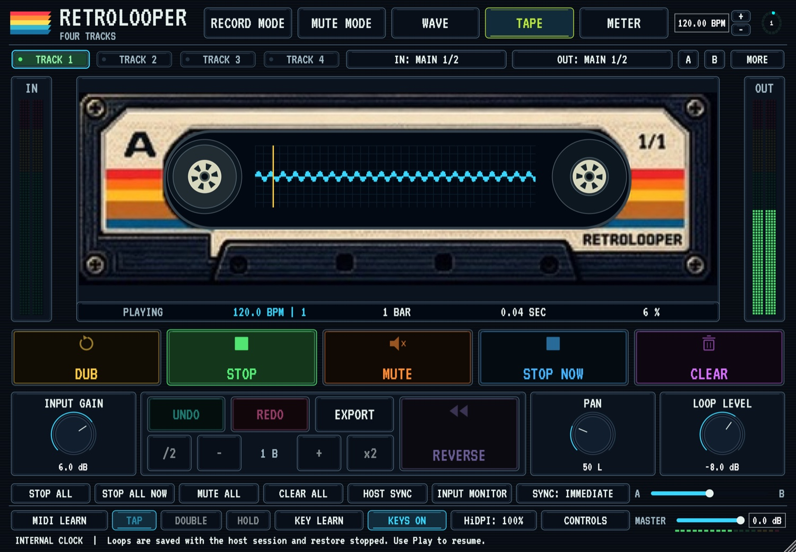
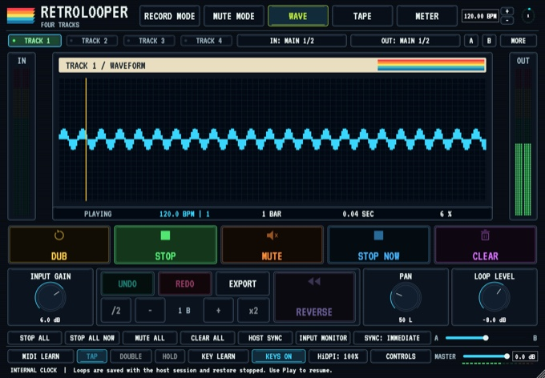
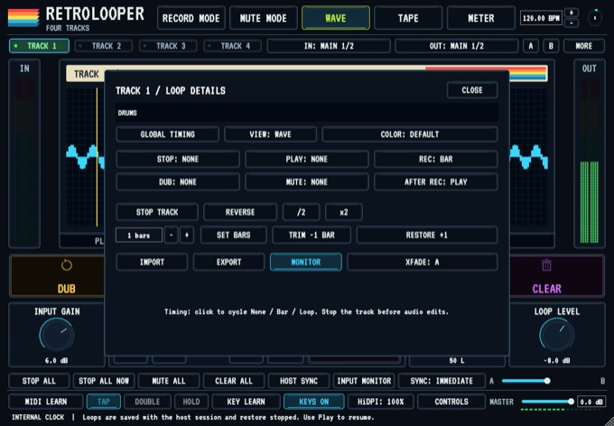
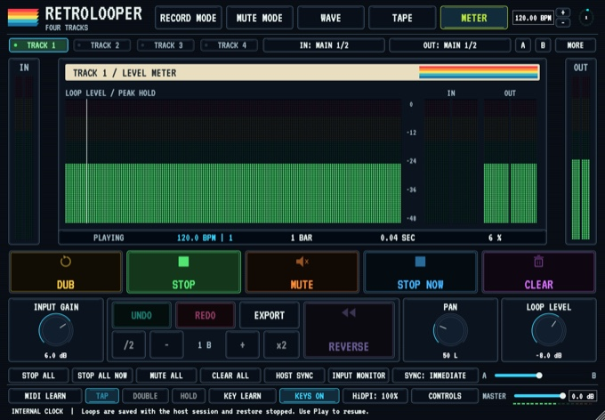
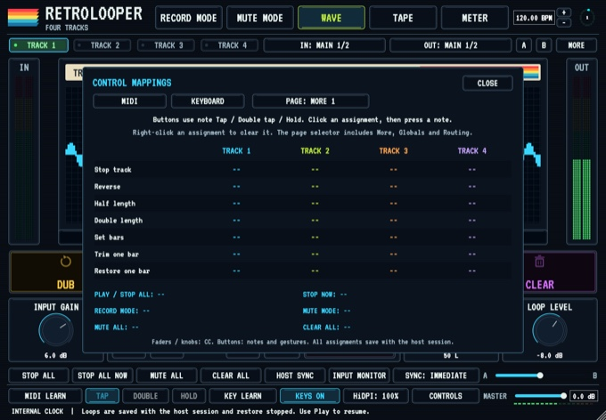
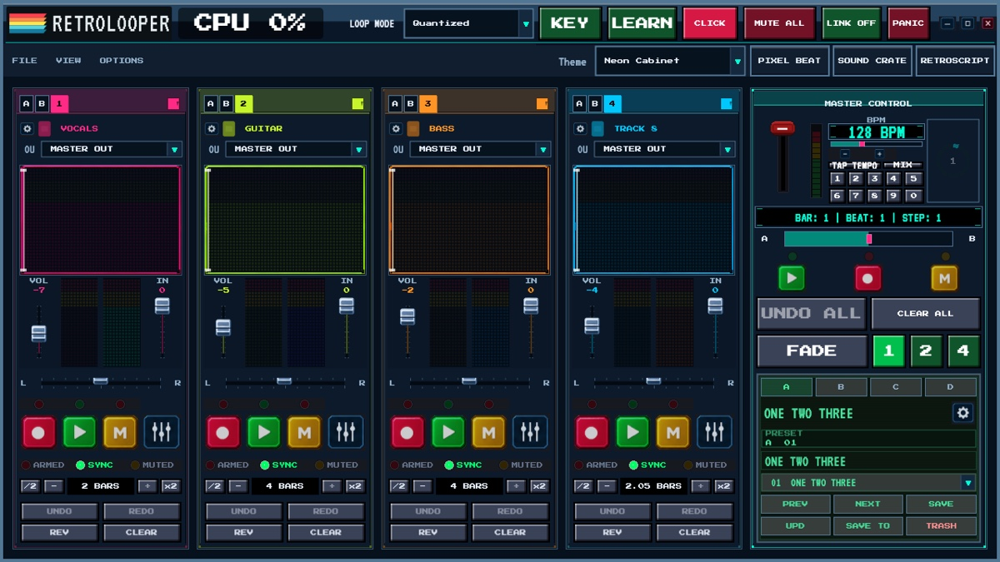

# Retrolooper

**Live audio looping by Retroloop USA / IAMTHEBAND LLC.** Use the standalone app for a live rig or add the four-track effect to your DAW.

## Download 1.1.0

| Platform | Included | Download |
| --- | --- | --- |
| macOS · Apple Silicon | Standalone app, VST3, Audio Unit | [Apple Silicon ZIP](https://github.com/asearan/Retrolooper/releases/download/v1.1.0/Retrolooper-1.1.0-macOS-Apple-Silicon.zip) |
| macOS · Intel | Standalone app, VST3, Audio Unit | [Intel ZIP](https://github.com/asearan/Retrolooper/releases/download/v1.1.0/Retrolooper-1.1.0-macOS-Intel.zip) |
| Windows · x64 | Standalone app and optional VST3 | [Windows Setup](https://github.com/asearan/Retrolooper/releases/download/v1.1.0/RetroLooper-1.1.0-Windows-x64-Setup.exe) |

[Download the PDF user guide](https://github.com/asearan/Retrolooper/releases/download/v1.1.0/RetroLooper-User-Guide.pdf) · [Release notes and checksums](https://github.com/asearan/Retrolooper/releases/tag/v1.1.0)

On macOS, unzip the download and move **Retrolooper.app** to Applications. On Windows, run **RetroLooper-1.1.0-Windows-x64-Setup.exe** and leave the VST3 option selected if you use a DAW. The macOS ZIPs include plug-in installation instructions. The macOS bundles are ad hoc signed and have no Apple notarization.

## Four tracks in your DAW

- Record, overdub, mute, reverse, undo, and export on four stereo loop tracks. A/B crossfading lets you blend groups of tracks.
- Follow your DAW transport and tempo. Choose immediate, bar, or loop timing for actions. Loop audio and assignments save with the DAW project.
- Route tracks independently in hosts that expose the extra stereo buses. Assign MIDI controls and keyboard shortcuts for live performance.

| Waveform and meters | Track settings and mapping |
| --- | --- |
|  **Waveform** for loop position and timing |  **Track settings** for routing, timing, and playback |
|  **Meters** for input and output levels |  **MIDI mapping** for controls, faders, and performance actions |

## Standalone for live performance

Build a setup with up to eight tracks, the mixer, per-track effects, MIDI and keyboard learn, and Ableton Link. The standalone app also includes PixelBeat, Retroscript, and Sound Crate.

For the single-track Akai effect and optional hardware Controls, see [Retrolooper One for MPC and Force](https://github.com/asearan/Retrolooper-One-MPC-Force).

[Donate via PayPal](https://paypal.me/adamsearan) to support Retrolooper development.

© 2026 Retroloop USA / IAMTHEBAND LLC.
