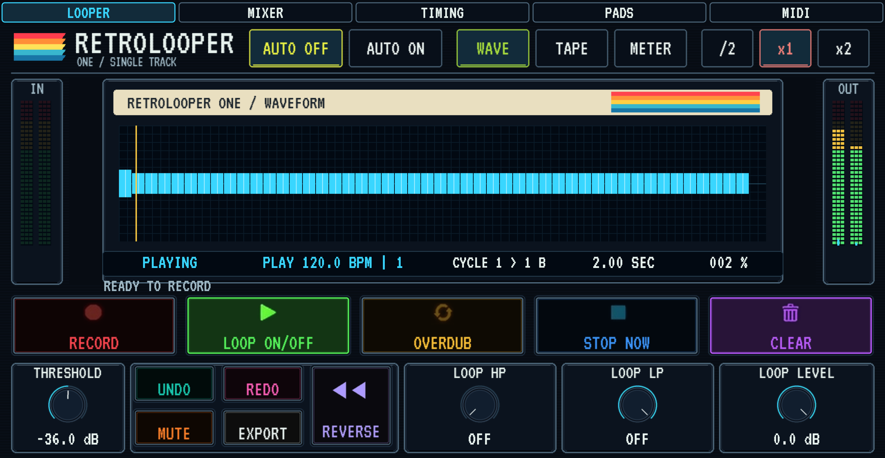
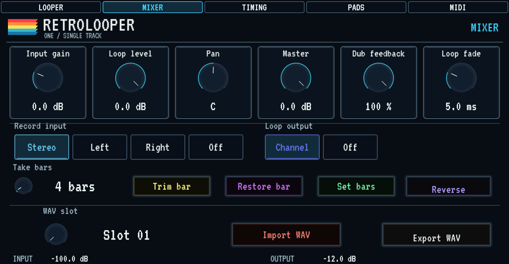
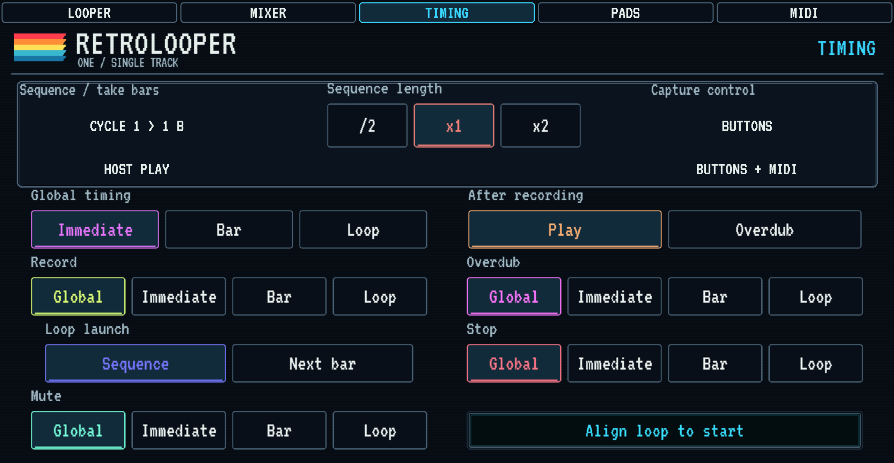
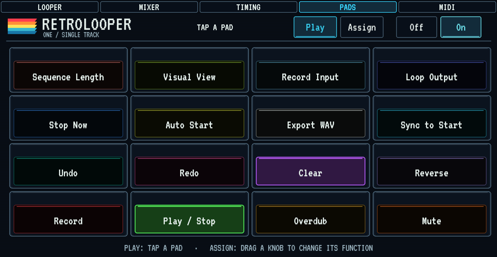
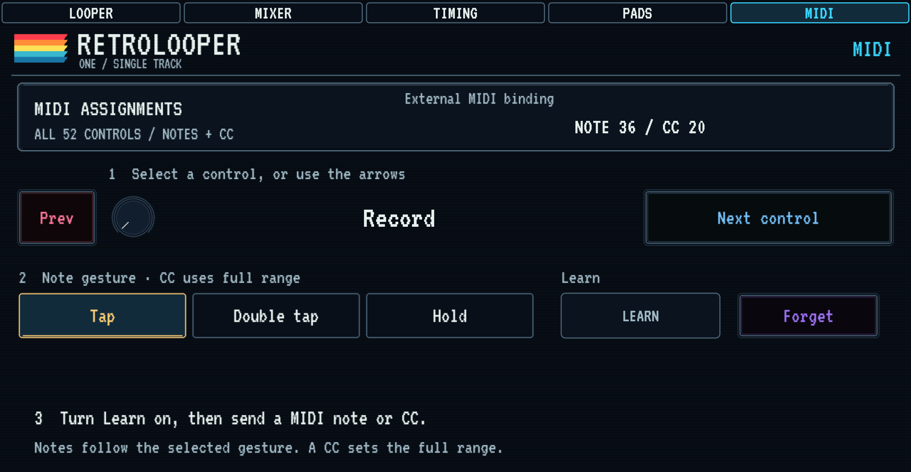

# Retrolooper

**Live audio looping by Retroloop USA / IAMTHEBAND LLC.** Use the standalone app for a live rig or add the four-track effect to your DAW.

## Download 1.1.0

| Platform | Included | Download |
| --- | --- | --- |
| macOS · Apple Silicon | Standalone app, VST3, Audio Unit | [Apple Silicon ZIP](https://github.com/asearan/Retrolooper/releases/download/v1.1.0/Retrolooper-1.1.0-macOS-Apple-Silicon-Host-Sync.zip) |
| macOS · Intel | Standalone app, VST3, Audio Unit | [Intel ZIP](https://github.com/asearan/Retrolooper/releases/download/v1.1.0/Retrolooper-1.1.0-macOS-Intel-Host-Sync.zip) |
| Windows · x64 | Standalone app and optional VST3 | [Windows Setup (revision 2)](https://github.com/asearan/Retrolooper/releases/download/v1.1.0/RetroLooper-1.1.0-Windows-x64-r2-Setup.exe) |

[Download the PDF user guide](https://github.com/asearan/Retrolooper/releases/download/v1.1.0/RetroLooper-User-Guide.pdf) · [Release notes and checksums](https://github.com/asearan/Retrolooper/releases/tag/v1.1.0)

On macOS, unzip the download and move **Retrolooper.app** to Applications. On Windows, run **RetroLooper-1.1.0-Windows-x64-r2-Setup.exe** and leave the VST3 option selected if you use a DAW. The macOS ZIPs include plug-in installation instructions. The macOS bundles are ad hoc signed and have no Apple notarization.

Windows alternatives: [portable app and VST3](https://github.com/asearan/Retrolooper/releases/download/v1.1.0/RetroLooper-1.1.0-Windows-x64-r2.zip) · [VST3 only](https://github.com/asearan/Retrolooper/releases/download/v1.1.0/RetroLooper-1.1.0-Windows-x64-r2-VST3.zip) · [Windows SHA-256 checksums](https://github.com/asearan/Retrolooper/releases/download/v1.1.0/SHA256SUMS-Windows-r2.txt).

## Four tracks in your DAW

- Record, overdub, mute, reverse, undo, and export on four stereo loop tracks. A/B crossfading lets you blend groups of tracks.
- Follow your DAW transport and tempo. Choose immediate, bar, or loop timing for actions. Loop audio and assignments save with the DAW project.
- Route tracks independently in hosts that expose the extra stereo buses. Assign MIDI controls and keyboard shortcuts for live performance.

| Waveform and meters | Track settings and mapping |
| --- | --- |
|  **Waveform** for loop position and timing |  **Track settings** for routing, timing, and playback |
|  **Meters** for input and output levels |  **MIDI mapping** for controls, faders, and performance actions |

## Standalone for live performance

Build a setup with up to eight tracks, the mixer, per-track effects, MIDI and keyboard learn, and Ableton Link. The standalone app also includes PixelBeat, Retroscript, and Sound Crate.

## Retrolooper One

Retrolooper One is the single-track looper for a Mac DAW. It is a separate plug-in from the four-track RetroLooper above.

### Download 1.0.0

| Mac | Included | Download |
| --- | --- | --- |
| Apple Silicon | Audio Unit and VST3 | [Apple Silicon installer](https://github.com/asearan/Retrolooper/releases/download/one-v1.0.0/Retrolooper-One-1.0.0-macOS-arm64.dmg) |
| Intel | Audio Unit and VST3 | [Intel installer](https://github.com/asearan/Retrolooper/releases/download/one-v1.0.0/Retrolooper-One-1.0.0-macOS-x86_64.dmg) |

[Release notes and checksums](https://github.com/asearan/Retrolooper/releases/tag/one-v1.0.0)

Open the disk image that matches the Mac. Double-click **Install Retrolooper One.pkg**. macOS asks for an administrator password. The package installs:

- `/Library/Audio/Plug-Ins/Components/Retrolooper One.component`
- `/Library/Audio/Plug-Ins/VST3/Retrolooper One.vst3`

Rescan plug-ins, then insert **Retrolooper One**. It is a music-effect Audio Unit and an effect VST3. The Apple Silicon package opens only on an Apple Silicon Mac, and the Intel package opens only on an Intel Mac. The plug-ins are Developer ID signed. This release is not notarized, so Gatekeeper can ask the first time you open a downloaded package. If macOS blocks it, right-click the package and choose Open.

This installer does not replace the four-track RetroLooper plug-in.

| Mixer and timing | Performance controls |
| --- | --- |
|  **Mixer** for level, pan, take length, and WAV import or export |  **Timing** for host cycle length and when record, overdub, stop, and mute happen |
|  **Pads** for playing and assigning controls |  **MIDI** for note and CC learn, including tap, double tap, and hold |

Host sync follows the DAW tempo and cycle. MIDI can be routed in and passed on. Learn is one button: choose a control and a gesture, turn Learn on, then send a note or CC.

For the single-track Akai effect and optional hardware Controls, see [Retrolooper One for MPC and Force](https://github.com/asearan/Retrolooper-One-MPC-Force).

[Donate via PayPal](https://paypal.me/adamsearan) to support Retrolooper development.

© 2026 Retroloop USA / IAMTHEBAND LLC.
